# Tiny City

A pixel-art screen saver where civilisation evolves while you're away.

Leave your computer alone and an empty patch of wilderness slowly grows into huts, farms, castles, factories, skyscrapers and, finally, a green future city full of electric cars, drones, solar towers and maglev trains. Move the mouse or press a key to come back. Next time you step away, the city picks up where it left off. Once it has enjoyed the green future for a while, the screen fades out and a new city begins from wilderness.

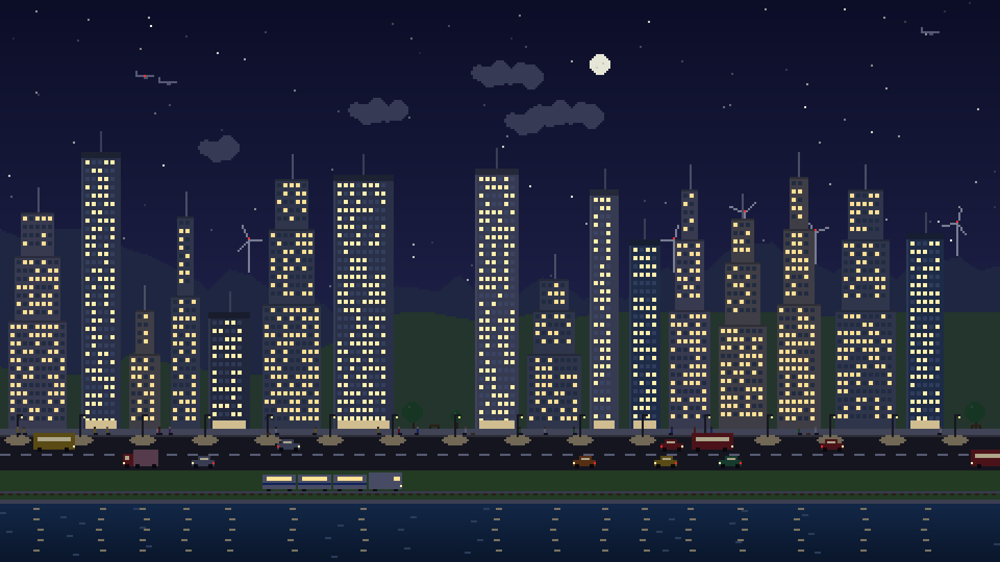

## The eras

| | |
|:-:|:-:|
| 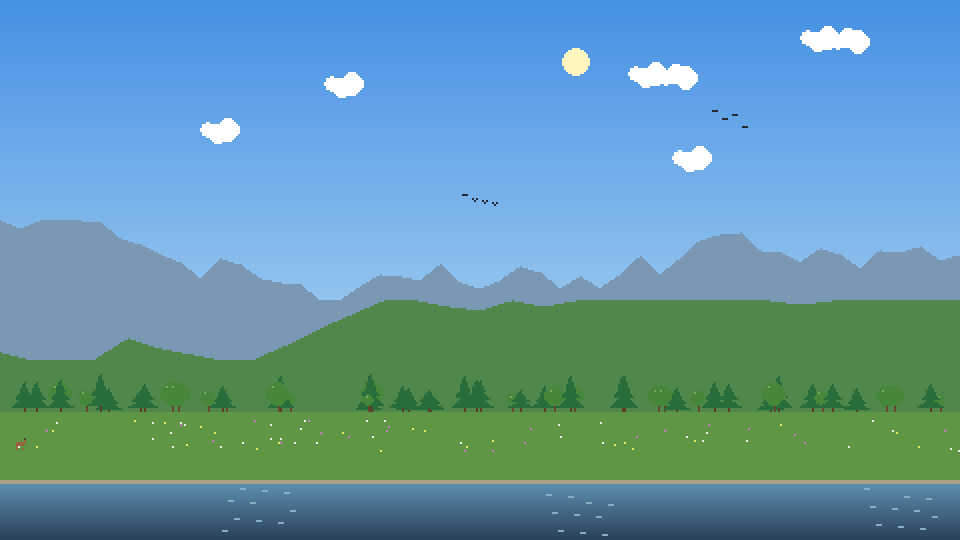 **Wilderness**<br>Trees and deer. | 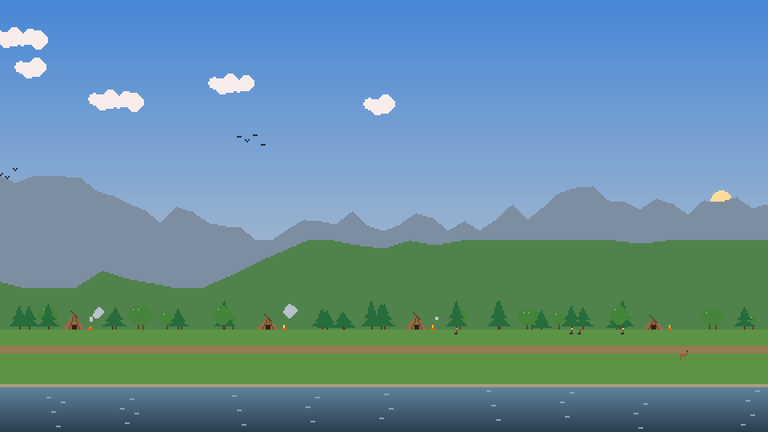 **Stone Age**<br>The first huts and campfires. |
| 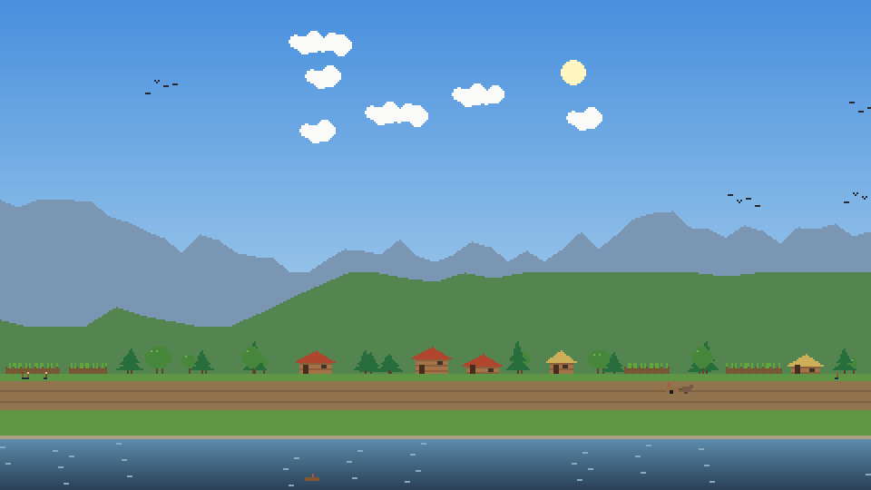 **Farming Village**<br>Fields, wooden houses, ox carts. | 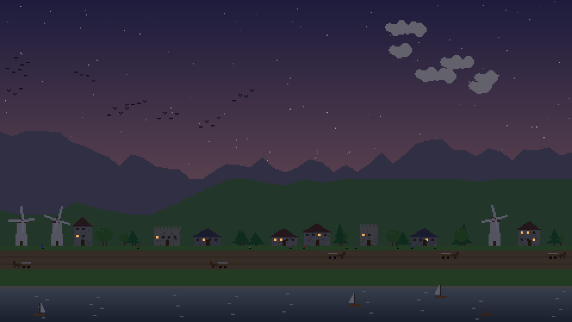 **Medieval Town**<br>Stone houses, windmills, castle towers. |
| 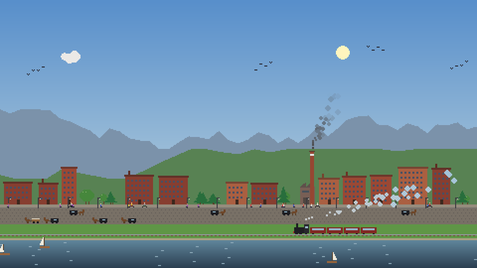 **Industrial Age**<br>Smokestacks and the first steam train. | 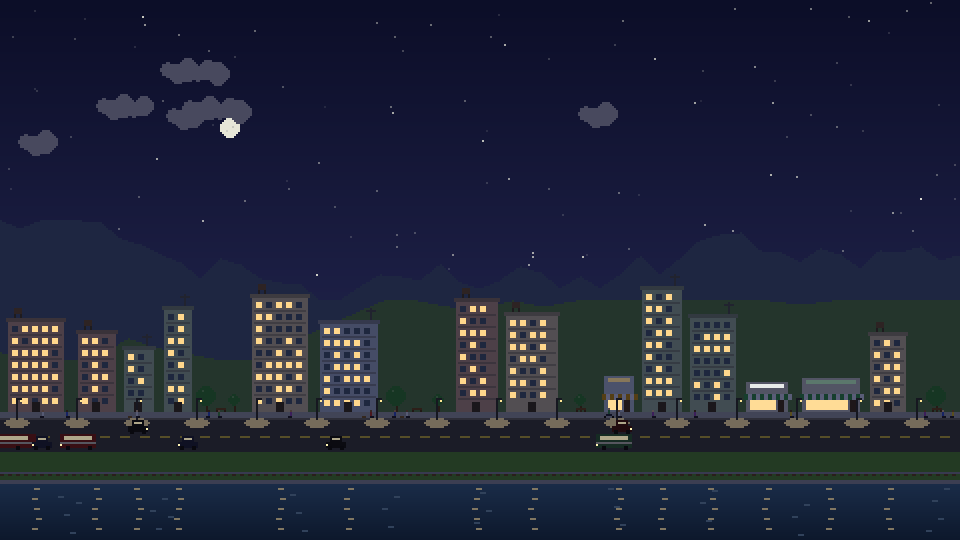 **Modern City**<br>Cars, apartment blocks, street lights. |
| 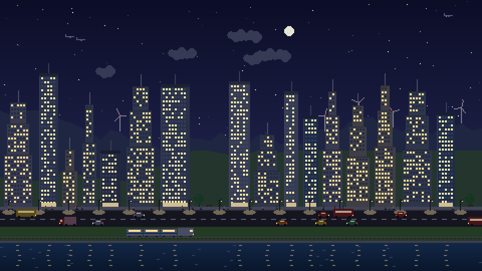 **Metropolis**<br>Skyscrapers, buses, planes. | 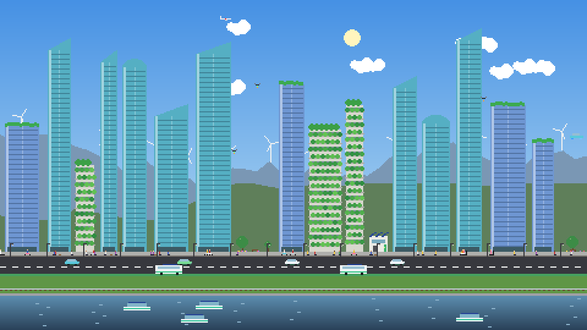 **Green Future**<br>Vertical forests, drones, maglev trains. |

It's light on your laptop: the graphics card does the scaling, and on battery it drops to 20 frames a second.

With more than one monitor, the city stretches across all of them as one wide panorama, and cars and trains drive from one screen to the next.

## Weather, seasons and celebrations

| | |
|:-:|:-:|
| 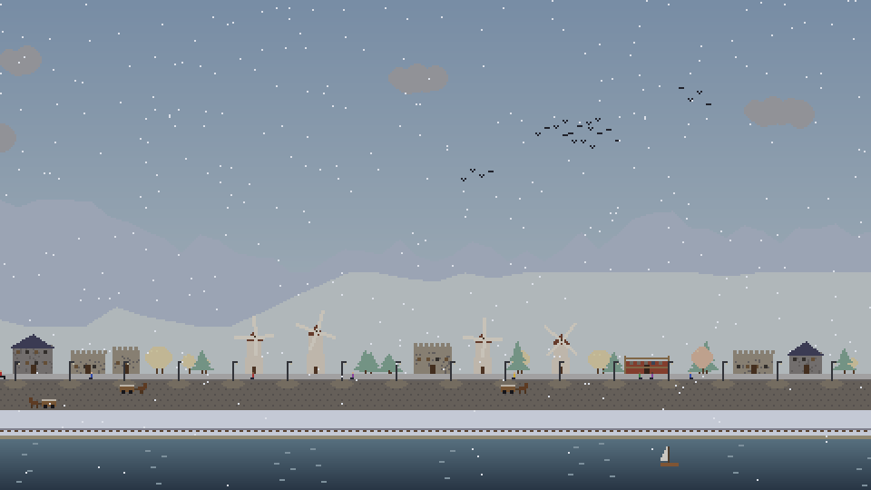 **Winter**<br>Snow settles on the ground, hills and trees. | 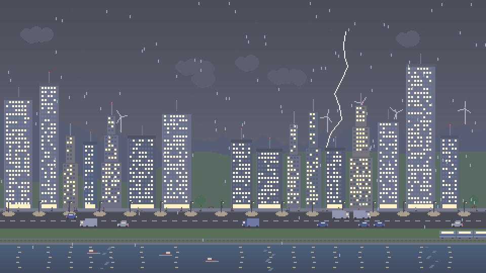 **Storms**<br>Rain, lightning, and windows lighting up. |
| 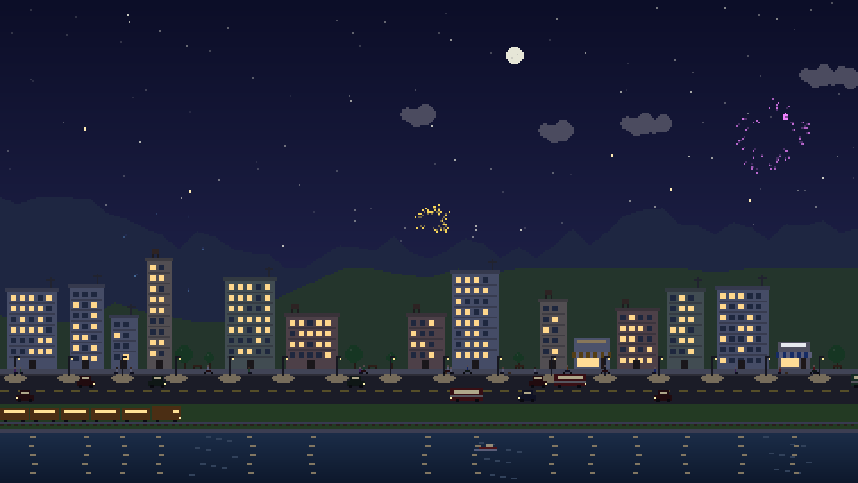 **Fireworks**<br>Every new era starts with a show. | 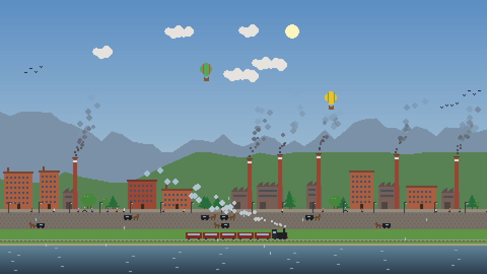 **Hot-air balloons**<br>From the Industrial Age, on fine days. |

A year passes every 12 days in the city, about half an hour. Trees blossom in spring and turn orange in autumn, with leaves drifting down. In winter it snows. The weather changes every minute or two, between clear skies, clouds, rain and summer thunderstorms, and grey skies dim the town.

Every so often the town holds a festival: bunting goes up over the street, crowds come out, lanterns glow at night and, from medieval times on, the night ends with fireworks.

The city also has a day and night cycle, with sunsets, stars, lit windows, smog that comes with industry and clears again later, boats on the river and traffic that changes with each era.

## Install on Windows

1. Download `TinyCity.scr` from the [latest release](https://github.com/derrickbarasa/evolution/releases/latest).
2. Right-click it and choose **Install**.
3. Set how many idle minutes to wait, and click **OK**.

The file isn't signed, so Windows may show "Windows protected your PC" the first time. Click **More info**, then **Run anyway**.

### Build it yourself

You need [Python 3](https://www.python.org/downloads/) to build it once. After that, the screen saver runs without Python.

```
git clone https://github.com/derrickbarasa/evolution.git
cd evolution
py -m venv .venv
.venv\Scripts\python.exe -m pip install pygame pyinstaller
.venv\Scripts\python.exe -m PyInstaller --noconfirm TinyCity.spec
copy dist\TinyCity.exe dist\TinyCity.scr
```

Then right-click `dist\TinyCity.scr`, choose **Install**, set how many idle minutes to wait, and click **OK**.

To pick how long each era lasts, click **Settings** in the screen saver dialog. The same window shows how far your city has grown, has a button to start a new one, and lets you turn off starting over after Green Future if you'd rather keep your finished city.

## Run it directly

Tiny City also runs as a normal program, on Windows, macOS or Linux, with `pip install pygame`:

```
python tiny_city.py                 start now, full screen
python tiny_city.py --window        windowed test mode (Esc quits, Right arrow skips an era)
python tiny_city.py --fast          every era lasts 15 seconds (demo)
python tiny_city.py --watch         sit in the background, start after 5 idle minutes
python tiny_city.py --watch --idle-minutes 10 --era-minutes 5
python tiny_city.py --new           forget the saved city and start from wilderness
python tiny_city.py --no-restart    keep the finished city instead of starting over after Green Future
python tiny_city.py --settings      open the settings window
```

`--watch` reads the system idle time. On Linux it needs `xprintidle` (`sudo apt install xprintidle`).

## Where things are saved

- The city: `%APPDATA%\TinyCity\` (`~/TinyCity/` on macOS and Linux). It's saved every 30 seconds and when you come back.
- Settings: `settings.json` in the same folder.

Each screen setup keeps its own city. Your laptop on its own, and your laptop with a monitor plugged in, each grow separately, so plugging in a screen never wipes your progress. **Start a new city** in the settings window clears them all.
